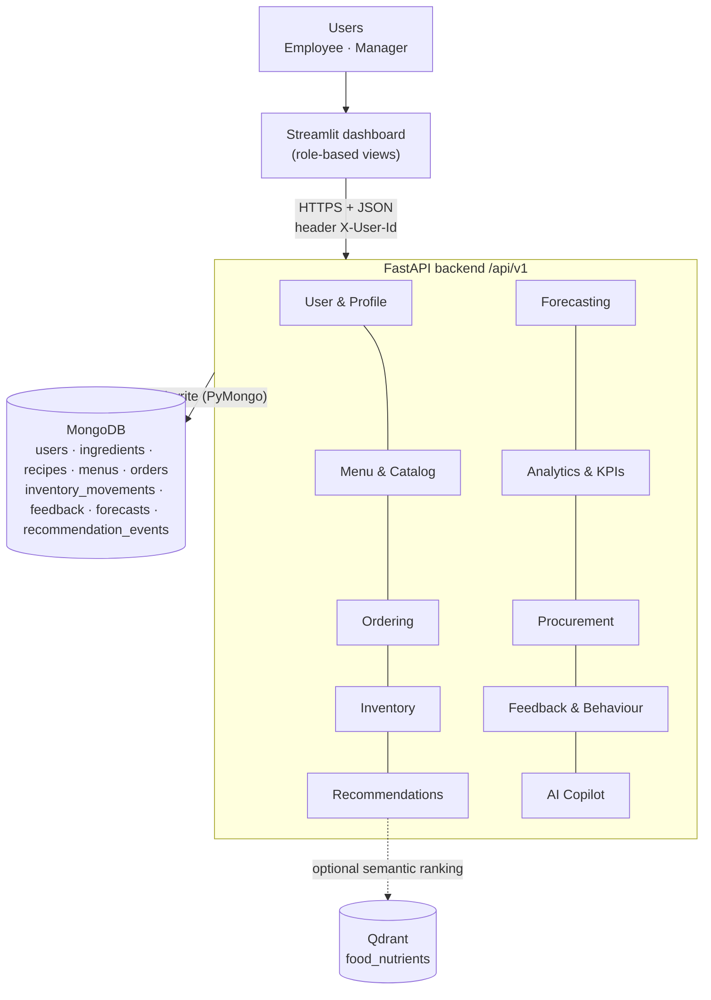

# ECOS API Endpoints — mapped to the Architecture

> **Enterprise Cafeteria Operating System**: data flows from employee actions to management decisions.
> This document maps every box in [Architecture.png](Architecture.png) to the FastAPI endpoints that implement it.
> It also lists the parts of the architecture that are not built yet.

| Item | Value |
|---|---|
| Base URL | `http://localhost:8000/api/v1` |
| Swagger (live, authoritative) | `http://localhost:8000/docs` |
| Machine-readable contract | [backend/api.json](backend/api.json) |
| Live endpoints | **33** across 10 modules |
| Database | MongoDB (PyMongo, sync) — 9 collections |
| Frontend | Streamlit [dashboard/](dashboard/) calls the API through [dashboard/api.py](dashboard/api.py) |

---

## 1. How the system connects



### The core flow

```
Excel upload → ingredients + recipes → Menu publish → Recommendation → Order (mock pay)
   → atomic ingredient deduction → movement log → stock alert → Forecast
   → Manager / Executive KPIs → Copilot answers from the same data
```

---

## 2. Conventions

| Topic | Rule |
|---|---|
| Identity | Send header `X-User-Id: <id>` after `POST /auth/login` (demo identity, not real auth) |
| Roles | `employee` (self-service) · `manager` (operations, procurement, leadership views) |
| Auth levels used below | **public** · **user** (any logged-in) · **self/mgr** (own data or manager) · **employee** · **manager** |
| Errors | `{"detail": "..."}` with `400` rule · `401` login · `403` role · `404` missing · `409` stock/concurrency · `413` file too large · `422` validation · `503` DB down |
| Dates | `YYYY-MM-DD`; timestamps are ISO-8601 UTC |
| Meal periods | `breakfast` · `snacks` · `lunch` · `dinner` |

---

## 3. Endpoints by architecture module

Status: ✅ built and tested · 🟡 partial · ❌ not built.

### 3.1 User & Profile
*Image features: user management · dietary preferences · allergen filters · role-based access*

| Method | Path | Auth | Purpose | Dashboard screen |
|---|---|---|---|---|
| POST | `/auth/login` | public | Log in; unknown ID auto-creates an **employee** (managers are seeded only) | Login |
| GET | `/users/{user_id}` | self/mgr | Read profile and preferences | Profile |
| PUT | `/users/{user_id}/preferences` | employee (self) | Save diet, wellness goals, allergens, favourites (**consent required**) | Profile |
| GET | `/users` | public | List users (`user_id, name, role, profile_complete` only) | — |

```json
// PUT /users/EMP001/preferences
{ "name": "Riya", "dietary_preference": "vegetarian",
  "wellness_goals": ["high_protein"], "declared_allergens": ["peanut"],
  "favourite_categories": ["indian"], "consented": true }
```

| Image feature | Status | Delivered by |
|---|---|---|
| User management | 🟡 | Login auto-provisioning + `GET /users`; no role edit or deactivation |
| Dietary preferences | ✅ | `PUT …/preferences` (`vegetarian / vegan / eggetarian / non_vegetarian / no_preference`) |
| Allergen filters | ✅ | Stored on the user; enforced in `/menu?user_id=`, `/recommendations` |
| Role-based access | 🟡 | 2 roles enforced on every write; Operations Team and Leadership use the **manager** role |

### 3.2 Menu & Catalog
*Image features: manage dishes/recipes · menu publishing · availability control · nutrition & allergens*

| Method | Path | Auth | Purpose | Dashboard screen |
|---|---|---|---|---|
| GET | `/recipes` | public | Dish catalogue (`?evidence_status=`) | Menu management |
| POST | `/upload/recipes` | manager | Excel/CSV recipe + ingredient lines (`mode=validate\|commit`) | Inventory → Upload recipes |
| GET | `/menu` | public | Published menu with **live availability** and max portions (`?meal_period&date&user_id`) | Employee Menu, Menu management |
| POST | `/menu` | manager | Publish a menu for date + meal period | Menu management |
| PATCH | `/menu/{menu_id}/items/{dish_id}` | manager | Pause / resume one dish `{"paused": true}` | Menu management |

**Recipe upload columns.** Required: `dish_id, dish_name, ingredient_id, quantity_per_portion`. Optional: `price, diet (veg|egg|non_veg), meal_periods (lunch|dinner), allergens (milk|wheat), protein_g, fibre_g, sodium_mg, energy_kcal, catalog_code, evidence_status`.
Nutrition tags (`high_protein`, `high_fibre`, `lower_sodium`, `balanced`) are **computed automatically**.

| Image feature | Status | Delivered by |
|---|---|---|
| Manage dishes/recipes | 🟡 | Bulk upload (upsert) + list; no single-dish edit/delete endpoint |
| Menu publishing | ✅ | `POST /menu` (only `confirmed` recipes) |
| Availability control | ✅ | Pause/resume + automatic “Ingredients out of stock” |
| Nutrition & allergens | ✅ | Stored per recipe; returned on menu + recommendations |

### 3.3 Ordering
*Image features: cart & checkout · order lifecycle · mock payment · order history*

| Method | Path | Auth | Purpose | Dashboard screen |
|---|---|---|---|---|
| POST | `/orders` | employee | Checkout cart → order, **mock payment**, atomic stock deduction | Cart panel |
| GET | `/orders` | user | History; managers filter `?date&status&user_id`, employees see only their own | My orders, Live orders |
| GET | `/orders/{order_id}` | self/mgr | Order detail | — |
| PATCH | `/orders/{order_id}/status` | manager | Lifecycle transition | Live orders |

```json
// POST /orders
{ "items": [{"dish_id": "DISH_MATAR_PANEER", "quantity": 2}], "recommendation_event_id": "REC-…" }
// 201 → { "success": true, "order_id": "ORD-…", "pickup_reference": "C482", "total": 280, "status": "confirmed" }
// 409 → { "detail": "Not enough Paneer in stock for this order" }
```

**Lifecycle:** `confirmed → preparing → ready → collected`. `cancelled` is allowed before `ready` and **restores stock**.

| Image feature | Status | Delivered by |
|---|---|---|
| Cart & checkout | ✅ | Cart held in Streamlit session; checkout = `POST /orders` |
| Order lifecycle | ✅ | `PATCH …/status` with guarded transitions + optimistic concurrency |
| Mock payment | ✅ | `payment: "demo_paid"`; no gateway |
| Order history | ✅ | `GET /orders` (+ rating attached) |

### 3.4 Inventory
*Image features: stock management · auto deduction (per order) · low stock alerts · inventory movements*

| Method | Path | Auth | Purpose | Dashboard screen |
|---|---|---|---|---|
| GET | `/inventory` | manager | Stock + status `HEALTHY / CRITICAL / STOCKOUT` (`?status=`) | Inventory |
| POST | `/inventory` | manager | Add one ingredient | Inventory → Add |
| PATCH | `/inventory/{ingredient_id}` | manager | Edit name / reorder point (threshold) | Inventory → Edit threshold |
| POST | `/upload/inventory` | manager | Excel/CSV stock load (`ingredient_id, name, quantity, unit, reorder_point`) | Inventory → Upload |
| GET | `/inventory/alerts` | manager | Items at/below reorder point + affected-dish count + suggested reorder | Today, Inventory |
| POST | `/inventory/{ingredient_id}/replenish` | manager | Receive stock `{"quantity": 5000, "note": "…"}` | Replenish dialog |
| GET | `/inventory/{ingredient_id}/affected-dishes` | manager | Dishes using it + portions still possible | Inventory detail |
| GET | `/inventory/{ingredient_id}/movements` | manager | Ledger (`opening_stock, stock_upload, order_consumption, order_cancelled, replenishment`) | Inventory detail |

| Image feature | Status | Delivered by |
|---|---|---|
| Stock management | ✅ | CRUD-lite + Excel upload + replenish |
| Auto deduction per order | ✅ | Conditional `$inc` per ingredient; **verified: 40 parallel orders on stock for 10 → exactly 10 accepted, no oversell** |
| Low stock alerts | ✅ | `quantity ≤ reorder_point` → CRITICAL, `≤ 0` → STOCKOUT |
| Inventory movements | ✅ | Every change writes `inventory_movements` |
| *(Ops Team)* Record waste | ❌ | No waste endpoint/movement type |

### 3.5 Recommendations
*Image features: Qdrant semantic search · nutrition-aware ranking · personalised suggestions · track conversion*

| Method | Path | Auth | Purpose | Dashboard screen |
|---|---|---|---|---|
| POST | `/recommendations` | user | Ranked, eligible, **in-stock** dishes with reasons | Employee Home, Menu |

```json
// POST /recommendations
{ "meal_period": "lunch", "query": "high protein vegetarian", "limit": 5 }
// → { "recommendation_event_id": "REC-…", "semantic_ranking": true,
//     "items": [{ "dish_id": "…", "semantic_score": 0.61, "goal_matches": 1, "reasons": ["Matches your high-protein goal", …] }] }
```

**Ranking** = `0.25 × goal matches + Qdrant similarity`. If Qdrant is down, ranking uses goal matches only.

| Image feature | Status | Delivered by |
|---|---|---|
| Qdrant semantic search | ✅ | [backend/app/core/semantic.py](backend/app/core/semantic.py) (optional, graceful fallback) |
| Nutrition-aware ranking | ✅ | Wellness goals vs recipe nutrition tags |
| Personalised suggestions | ✅ | Diet + allergen filter + goals + availability |
| Track conversion | ✅ | `recommendation_events` + `recommended` flag on order lines → `recommendation_share` KPI |

### 3.6 Forecasting
*Image features: demand prediction · ingredient requirement · waste & revenue forecast · historical trend analysis*

| Method | Path | Auth | Purpose | Dashboard screen |
|---|---|---|---|---|
| POST | `/forecast/run` | manager | Same-weekday average over N weeks → customers, dish portions, ingredient needs, shortfalls, projected value | Forecasting |
| GET | `/forecast/latest` | manager | Latest saved forecast (`?forecast_date=`) | Forecasting |

```json
// POST /forecast/run
{ "date": "2026-11-02", "meal_period": null, "buffer_percent": 5, "weeks": 4 }
```

| Image feature | Status | Delivered by |
|---|---|---|
| Demand prediction | ✅ | `expected_customers`, `dishes[].expected_orders` (baseline; 10 portions/dish if no history) |
| Ingredient requirement | ✅ | `ingredients[]` required vs on-hand → `shortfalls[]` |
| Revenue forecast | ✅ | `projected_order_value` |
| Waste forecast | ❌ | Needs waste data first (see 3.4) |
| Historical trend analysis | ✅ | `/dashboard/executive` `monthly_trend`, `forecast_vs_actual`; `/wellness/{id}/trend` |

> ML in [ml/](ml/) is not connected to the API. Forecasts use a transparent baseline that is easy to explain.

### 3.7 Analytics & KPIs
*Image features: manager dashboard · operations dashboard · executive dashboard · real-time KPI computation*

| Method | Path | Auth | Purpose | Dashboard screen |
|---|---|---|---|---|
| GET | `/dashboard/employee/{user_id}` | self/mgr | Active/previous order, wellness snapshot, current period | Employee Home |
| GET | `/dashboard/manager` | manager | Today: orders, value, AOV, status mix, top dishes, rating, healthy %, rec share, stock alerts, expected vs actual customers | Today |
| GET | `/dashboard/executive` | manager | `?days=7\|30\|90`: customer, operations, inventory, financial blocks + trends | Executive |

| Image feature | Status | Delivered by |
|---|---|---|
| Manager dashboard | ✅ | `/dashboard/manager` |
| Operations dashboard | 🟡 | Covered by manager Today + Inventory + Live orders; no separate ops endpoint |
| Executive dashboard | ✅ | `/dashboard/executive` |
| Real-time KPI computation | ✅ | Computed per request from live collections (`as_of` timestamp) |

### 3.8 Procurement (Simplified)
*Image features: reorder recommendations · affected dish analysis · supplier info (basic) · lead-time estimates (rule-based)*

No dedicated router. These existing endpoints cover procurement:

| Image feature | Status | Delivered by |
|---|---|---|
| Reorder recommendations | ✅ | `GET /inventory/alerts` → `suggested_replenishment = 2 × reorder_point − quantity` (prototype rule) |
| Affected dish analysis | ✅ | `GET /inventory/{id}/affected-dishes`, `affected_dishes` count in alerts |
| Supplier info (basic) | ❌ | No supplier field/collection |
| Lead-time estimates | ❌ | Not modelled |
| Forecast-driven buying | ✅ | `POST /forecast/run` → `shortfalls[]` |

### 3.9 Feedback & Customer Behaviour
*Image features: ratings & reviews · customer preferences · repeat order analysis · healthy meal adoption*

| Method | Path | Auth | Purpose | Dashboard screen |
|---|---|---|---|---|
| POST | `/feedback` | user (order owner) | Rate an order 1–5 + reason + comment (one per order) | My orders |
| GET | `/wellness/{user_id}/monthly` | self/mgr | Monthly scorecard: **wellness score** (starts at 20; +10 per healthy portion, +5 per other portion ordered this month; max 100), healthy-category %, goal progress, recommendation engagement | Home, My wellness |
| GET | `/wellness/{user_id}/trend` | self/mgr | 1–24 month trend of healthy categories | My wellness |

| Image feature | Status | Delivered by |
|---|---|---|
| Ratings & reviews | ✅ | `POST /feedback`; `average_rating` in manager/executive |
| Customer preferences | ✅ | User preferences (3.1) |
| Repeat order analysis | ✅ | `repeat_order_rate` in `/dashboard/executive` |
| Healthy meal adoption | ✅ | `healthy_meal_adoption` (manager, executive, monthly trend) + personal scorecard |

### 3.10 AI Copilot (Read-only)
*Image features: natural language queries · operational insights · uses menu, inventory, orders · evidence-based answers · no direct data modification*

| Method | Path | Auth | Purpose | Dashboard screen |
|---|---|---|---|---|
| POST | `/copilot` | manager | `{"question": "…"}` → `intent, answer, evidence[], read_only: true` | Copilot |
| GET | `/copilot/suggestions` | public | Suggested prompts | Copilot |

**Intents:** `inventory_alerts`, `affected_dishes`, `forecast`, `healthy_trend`, `recommendation_conversion`, `top_dishes`, `sales_summary`.

| Image feature | Status | Delivered by |
|---|---|---|
| Natural-language queries | 🟡 | Keyword intent matcher, without an LLM. The response shape supports adding an LLM later. |
| Operational insights / evidence | ✅ | Same aggregations as the dashboards + `evidence[]` lines |
| No direct data modification | ✅ | Read-only queries only |

### 3.11 Platform

| Method | Path | Auth | Purpose |
|---|---|---|---|
| GET | `/health` | public | `{"status": "healthy", "database": "connected"}`; dashboard shows a reconnect banner if down |

---

## 4. Right-hand side of the image

| Image box | Status | Notes |
|---|---|---|
| **Qdrant** (food embeddings, similar dishes) | ✅ | Used for ranking; no standalone “similar dishes” endpoint |
| **LLM (optional)** | ❌ | Not wired. Copilot uses intent rules. |
| **Background jobs**: forecast refresh, KPI aggregation, stock alert checks, data enrichment | 🟡 | All run **on demand**: you trigger a forecast, and KPIs and alerts are computed when requested. Nothing is scheduled. |
| **MongoDB**: Users, Recipes & Ingredients, Menus, Orders, Inventory & Movements, Feedback, Forecast Results | ✅ | Plus `recommendation_events` |
| **MongoDB**: KPI Snapshots | ❌ | KPIs are calculated live and not stored |
| “Motor – Async” | 🟡 | Uses synchronous PyMongo. FastAPI runs sync routes in a thread pool, which is fine at demo scale. |

---

## 5. Original minimal contract vs implementation

Contract source: [API endpoints.txt](API%20endpoints.txt) (final “bare-minimum” section).

| Contract | Implemented as | Note |
|---|---|---|
| `POST /upload/inventory` | same | Column `threshold` → `reorder_point`; `ingredient_name` → `name`; `unit_cost` not stored |
| `POST /upload/recipes` | same | Adds `diet`, `meal_periods`, nutrition columns |
| `GET /menu`, `POST /menu` | same | + `PATCH /menu/{id}/items/{dish}` pause |
| `POST /orders` | same | `user_id` comes from header, not body |
| `GET /orders` | same | |
| `PATCH /orders/{order_id}` | `PATCH /orders/{order_id}/status` | |
| `GET /inventory`, `GET /inventory/alerts` | same | |
| `POST /inventory/add` | `POST /inventory/{ingredient_id}/replenish` | |
| `POST /recommendations` | same | `user_id` from header |
| `POST /forecast/run`, `GET /forecast/latest` | same | |
| `POST /feedback` | same | |
| `GET /dashboard/customer/{user_id}` | `GET /dashboard/employee/{user_id}` + `/wellness/*` | |
| `GET /dashboard/manager`, `GET /dashboard/executive` | same | |
| `GET /dashboard/procurement` | ❌ not built | Data available via `/inventory/alerts` |
| `POST /copilot` | same | + `GET /copilot/suggestions` |

---

## 6. Gaps to close (prioritised)

| # | Gap | Image module | Effort | Suggested endpoint |
|---|---|---|---|---|
| 1 | Record waste | Inventory / Ops Team | S | `POST /inventory/{id}/waste` → movement `waste` |
| 2 | Procurement view + supplier/lead time | Procurement | S | `GET /dashboard/procurement`; optional `supplier`, `lead_time_days` upload columns |
| 3 | Waste forecast | Forecasting | M | Extend `/forecast/run` once #1 has data |
| 4 | Real authentication | User & Profile | M | Replace `X-User-Id` with signed tokens |
| 5 | Scheduled jobs + KPI snapshots | Background Jobs | M | Nightly forecast + daily KPI snapshot |
| 6 | LLM copilot | AI Copilot / LLM | M | LLM → existing intents |

> ⚠️ **Security note:** `X-User-Id` is a demo identity, and anyone can send `MGR001`. Use real authentication before any shared deployment.

---

## 7. How it was verified

| Suite | Command | Result |
|---|---|---|
| Backend API smoke (60+ checks, throwaway `ECOS_test` DB) | `ECOS_MONGODB_DB=ECOS_test .venv/bin/python -m backend.smoke_test` | ✅ all passed |
| UI journeys (Streamlit AppTest, employee + manager) | start API on 8011 with `ECOS_MONGODB_DB=ECOS_uitest`, then `ECOS_API_URL=http://localhost:8011/api/v1 .venv/bin/python -m dashboard.ui_smoke_test` | ✅ 21/21 |
| Edge cases: role blocking, validation bounds, upload validate-only, **concurrent oversell**, stockout propagation to menu/alerts/copilot/KPIs | ad-hoc probe | ✅ 26/26 |
