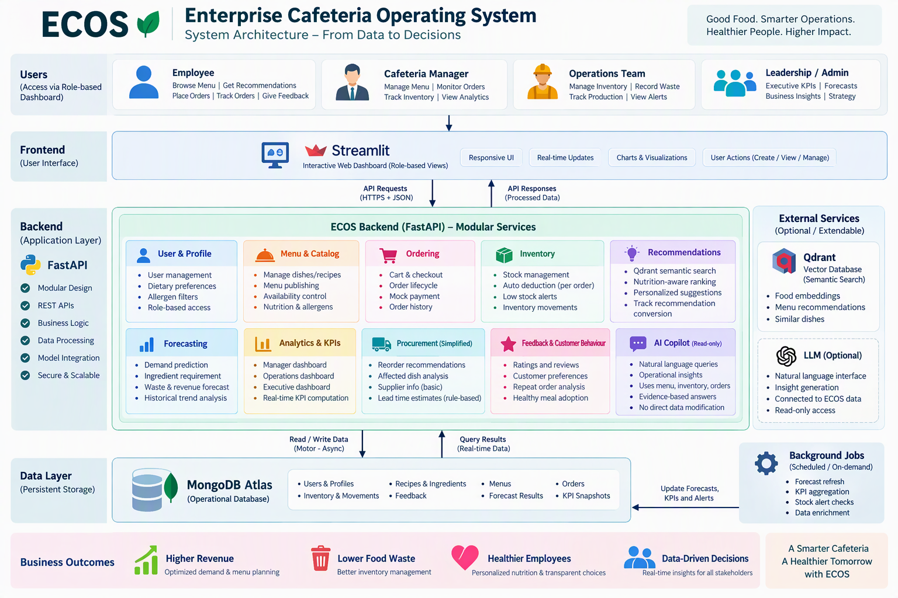
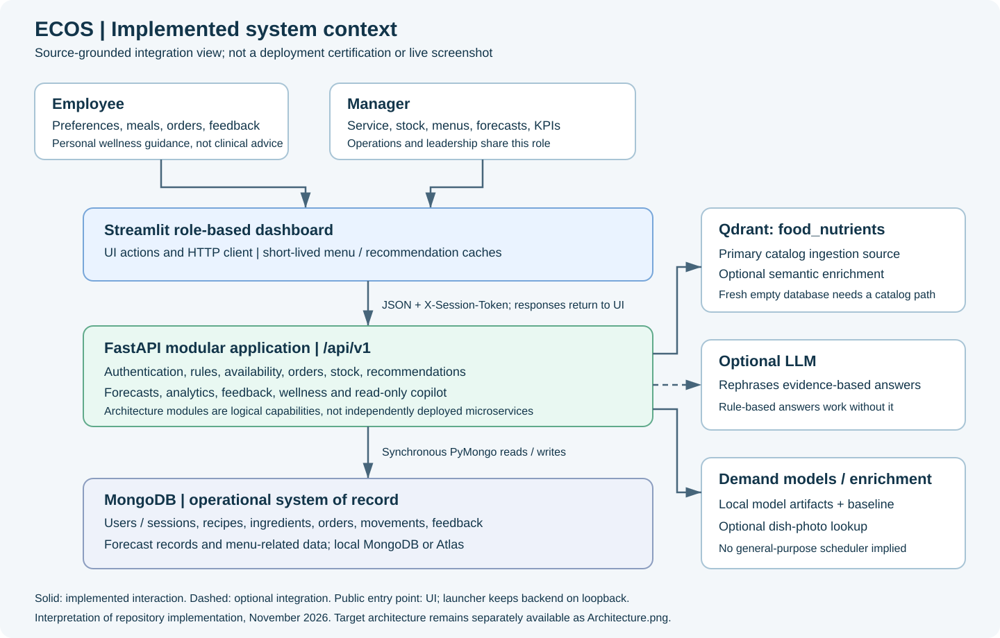
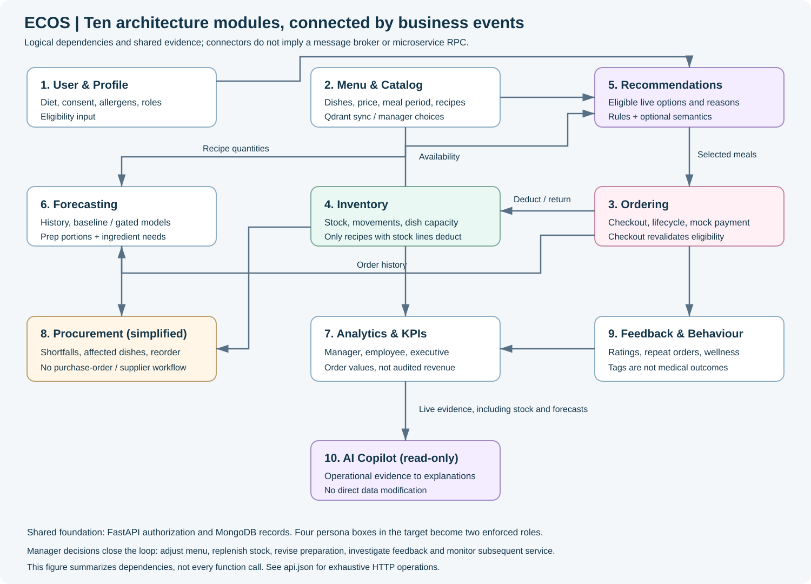
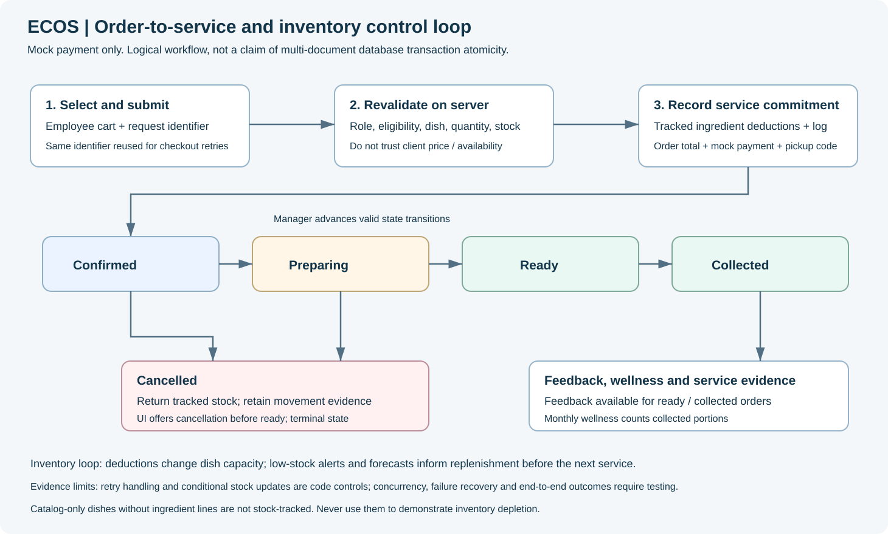
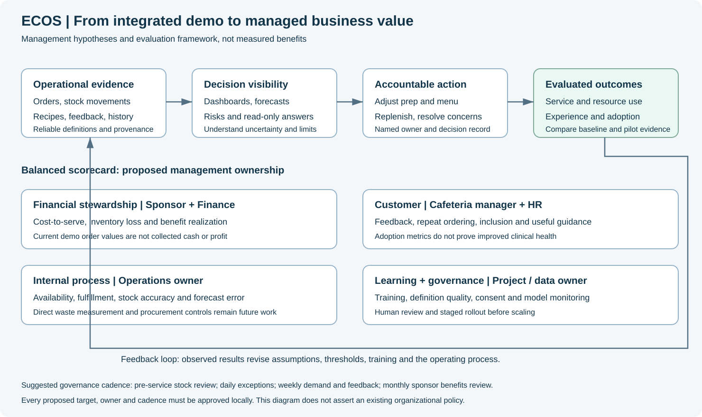

# ECOS application and backend guide

**Enterprise Cafeteria Operating System**  
Companion to the [MBA final report](FINAL_PROJECT_REPORT.md), [modular API catalog](../api.json), and [existing endpoint notes](../API_ENDPOINTS.md).

## 1. Purpose and evidence boundary

ECOS connects employee meal selection to cafeteria service, ingredient availability, demand planning, and managerial oversight. It is an integrated project demonstration, not an enterprise certification. The project owner reports that the working integration is complete. This guide describes repository-inspected behavior; it does not assert that a new live database, load test, or user acceptance study was executed while preparing the documentation.

The distinction matters:

| Evidence class | Meaning in this guide |
|---|---|
| Implemented | A corresponding route, function, or UI workflow exists in the source |
| User-reported | The owner reports a working integrated demo |
| Configuration-dependent | Requires data, an external service, credentials, or model artifacts |
| Proposed / not implemented | An architecture aspiration or recommendation, not a delivered result |
| Synthetic | An example supplied to explain a contract, not a captured employee record |

No sample in the API catalog should be treated as audited operational evidence.

### Reading paths

- **MBA evaluator:** report executive summary, management value chain, scope/gaps, investment assumptions, integration evidence, recommendations.
- **Demonstrator:** prerequisites, employee and manager journeys, rehearsal checklist, failure scenarios.
- **Backend developer:** API catalog, module connections, request lifecycle, source map, validation instructions.
- **Operations owner:** stock-linked recipes, forecast interpretation, inventory risk, daily management routine.

## 2. Architecture at a glance

### Original target design



The original design is the organizing taxonomy. It is not proof that every capability in every box is delivered. In particular, role names, asynchronous storage, scheduled jobs, procurement depth, and AI integrations require the qualifications below.

### Implemented system context



### Module dependencies



### Order and stock lifecycle



### Management value chain



These are original explanatory diagrams, not screenshots or evidence of live uptime.

### Physical and logical boundaries

1. A browser displays the Streamlit application.
2. The dashboard's [HTTP client](../dashboard/api.py) calls FastAPI using JSON and `X-Session-Token`.
3. FastAPI applies authentication, authorization, input validation, and operational rules.
4. MongoDB stores operational records through **synchronous PyMongo**, not the target image's Motor/async implementation.
5. Qdrant's `food_nutrients` collection supplies catalog data and can enhance semantic matching. An already populated operational catalog can continue to serve basic flows without semantic ranking; a fresh database still needs a catalog/recipe provisioning path.
6. Demand planning uses a historical baseline, or compatible trained demand models that pass the implemented baseline gate.
7. Copilot is read-only. Rule-based answers do not require an LLM; optional LLM use is configuration- and dependency-dependent.

The ten architecture modules are capabilities within one modular FastAPI application. They are **not ten separately deployed microservices**. Do not describe the diagrams as event-bus, distributed-transaction, or real-time streaming architecture: those facilities are not established by the diagram.

## 3. Delivered scope by architecture module

| Module | What the project supports | Important limit |
|---|---|---|
| User & Profile | Login/employee auto-registration, sessions, profile, dietary preferences, declared allergens, consent, role checks | Only `employee` and `manager` are enforced roles; no full HR identity lifecycle |
| Menu & Catalog | Catalog synchronization, recipe browsing, inclusion/exclusion, prices, meal periods, nutrition/allergen display, uploads | A catalog dish without ingredient lines is not inventory-constrained; estimated prices need managerial review |
| Ordering | Cart, checkout, retry identifier, mock payment, pickup reference, history, manager status transitions | No payment gateway, bank settlement, tax invoice, or verified cash revenue |
| Inventory | Ingredients, quantities, reorder points, replenishment, movement history, consumption, affected dishes, risk | Not a warehouse suite: no demonstrated batch expiry, lot traceability, supplier receiving, or unit conversion engine |
| Recommendations | Eligibility filtering, preference/goal ranking, explanations, query interpretation, optional semantics, day plan | Match scores are not clinical assessments or calibrated probabilities |
| Forecasting | On-demand forecast, preparation buffer, ingredient requirement/shortfall, model training/status | No accuracy claim without recorded evaluation; no scheduler should be inferred |
| Analytics & KPIs | Employee, manager, executive views; order values, fulfillment, ratings, repeat behavior, adoption trends | Metric populations differ; order values are not audited revenue, margin, or cash receipts |
| Procurement (simplified) | Stock risk, replenishment support, affected-dish information, forecast shortfalls | No end-to-end purchase order, approved supplier master, vendor negotiation, invoice matching, or automated buying |
| Feedback & Customer Behaviour | Order-linked ratings/comments, repeat ordering, recommended share, monthly wellness/trend | Recommendation share is not impression-based conversion; healthy-tag adoption is not measured health improvement |
| AI Copilot | Suggested questions, operational evidence, read-only answers; optional LLM | No direct data modification; natural-language output is not an authoritative operational approval |

The catalog contains exhaustive HTTP operations; a module can be supported by several routers. Wellness, uploads, catalog maintenance, and model operations should not disappear from the backend view merely because they are not separately named in the original image.

## 4. Roles, accounts, and sessions

### Employee

Navigation: **Home**, **Menu**, **My orders**, **My wellness**, **Profile**. Cart is an employee sidebar workflow.

An unknown user ID with a valid password registers an employee. This is a demo onboarding decision, not an enterprise SSO workflow. Do not enter a new ID accidentally when attempting to access an existing account.

The profile captures:

- Name.
- Dietary preference: no preference, vegetarian, vegan, eggetarian, or non-vegetarian.
- Wellness goals: high protein, high fibre, lower sodium, balanced.
- Declared allergen exclusions.
- Favourite categories.
- Consent to personalization and the wellness scorecard.

Preference storage requires consent. The interface does not establish a complete data-subject request, erasure, or consent-withdrawal program.

### Manager

Navigation: **Today**, **Live orders**, **Inventory**, **Menu management**, **Forecasting**, **Executive**, **Copilot**.

The manager identity/password comes from server configuration. Operations and leadership personas in the original architecture currently use the same manager role. A management report must not claim four independently permissioned role dashboards.

### Session behavior

The API returns a session token after login. The HTTP client adds `X-Session-Token`. Browser refresh restoration uses an `ecos_session` cookie; server-side validation remains authoritative. Sessions have a 30-minute idle policy, with keep-alive/restoration checks during use. Logout revokes the session.

The repository includes password/lockout/session controls; their existence is not a substitute for a production security assessment. Keep real credentials and session tokens out of screenshots, reports, notebooks, and committed JSON examples.

## 5. Employee operating guide

### 5.1 First-time onboarding

1. Open the dashboard and enter a deliberate new employee ID.
2. Choose a password of at least eight characters.
3. Complete the Profile form, if personalization is wanted.
4. Select diet, goals, allergens, and favourite categories.
5. Read the nutrition/allergen disclaimer.
6. Check consent and save.
7. Open Menu or Home to see current eligible suggestions.

**Control:** declared allergens and dietary constraints are not merely display labels. Server-side ordering checks must remain the final decision point when a cart is submitted.

### 5.2 Home

Home shows the employee greeting, profile-completion prompt when applicable, meal-period recommendations, active order, and a monthly wellness summary. Availability depends on current menu and stock evidence. A lack of eligible dishes is a legitimate result, not a reason to bypass exclusions.

### 5.3 Menu modes

**For you**

- Select a meal period.
- Enter an optional request such as a dish/category or goal.
- Inspect recommendation reasons and whether the response indicates semantic or goal-based ranking.
- Use **Show different options** to move through results and **Refresh** to reset the selection.

**Full menu**

- Search by dish text and browse paged results.
- Review availability, price, nutrition, and declared allergens.
- A new empty catalog can show a preparation/synchronization message.
- A dish can be visible but unavailable or ineligible; its Add button is disabled accordingly.

**Plan my day**

- Request a plan, optionally shaped by preferences/query.
- Inspect one selected dish per supported meal period and nutrient totals.
- Add individual dishes or the whole proposed plan.
- Treat the plan as cafeteria choice support, not a complete clinical dietary prescription.

Detailed nutrient views show macros and micronutrients where the catalog link exists. Missing nutrient linkage is not equivalent to zero nutrients. Approximate daily-reference percentages are explanatory.

### 5.4 Cart and checkout

1. Add an available and eligible dish.
2. Open Cart.
3. Adjust quantities or remove lines.
4. Inspect the displayed total.
5. Click **Place order**.
6. Retain the pickup reference shown in My orders.

The dashboard supplies a `client_request_id` and reuses it on retries. This supports duplicate-request handling; it does not establish that every possible failure/concurrency scenario has been tested. The server, not the cached cart, determines current acceptability and price.

**No money is taken.** The payment is a demonstration. Do not present an order total as bank collection.

If checkout is rejected because stock, eligibility, or menu status changed, inspect the message and revise the cart. Do not repeatedly generate fresh retry identifiers for the same uncertain transaction without checking order history.

### 5.5 Order tracking, reorder, and feedback

The ordinary manager-controlled lifecycle is:

`confirmed -> preparing -> ready -> collected`

Cancellation is offered while confirmed or preparing. It is not a general “undo any historical order” function.

My orders shows items, date, meal period, total, pickup reference, and status. Reorder recreates cart selections; it is not guaranteed to preserve old prices or availability at the next checkout.

Feedback is offered for ready/collected orders not already rated. Choose a rating from 1 to 5, a reason (taste, portion, quality, waiting time, other), and an optional comment. This is a voluntary order-linked feedback mechanism, not a representative employee survey.

### 5.6 Monthly wellness

Select a month to inspect:

- Collected portions tracked.
- High-protein, high-fibre, lower-sodium, and balanced tag shares.
- Goal progress.
- Recommended meals ordered/share.
- Meal-period coverage and top dishes.
- Six-month tag trends.

The displayed score is a project heuristic: baseline 20, +10 per healthy-tagged portion and +5 per other portion, capped at 100. Collected meals count; pending collection is shown separately.

**Interpretation:** this score can saturate through ordering frequency. It does not measure biomarkers, total daily intake, nutritional adequacy, productivity, employee performance, or medical health. Category percentages can overlap because one dish can carry several tags.

## 6. Manager operating guide

### 6.1 Today

Use Today as an exception-oriented start-of-service view:

- Orders, active orders, collected orders.
- Accepted order value and average order value.
- Average rating, healthy-meal adoption, recommendation share.
- Critical stock, stockouts.
- Expected customers from an available forecast, actual distinct ordering employees.
- Top dishes and inventory alerts.

Read `as_of`, data-state indicators, and absent values. “No forecast” is not “zero demand.” A missing rating average is not a zero-star score.

### 6.2 Live orders

Filter by service date, status, and employee ID. Review item quantities and pickup references before advancing status. Use the next permitted transition, and only cancel in an allowed state.

The UI provides refresh controls; “live” here means current API reads on interaction, not a guaranteed push subscription or service-level latency.

### 6.3 Inventory: Stock

- Inspect Healthy, Critical, and Stockout counts.
- Filter to items needing attention.
- Select an ingredient row for detail.
- Review affected dishes and recent movements.
- Replenish after a physical receipt/count decision, using a clear note.

Critical means at or below reorder point; zero stock is a stockout. Units must be understood before adjusting quantities. Do not add a quantity in kilograms to a record whose unit is grams.

### 6.4 Inventory: Today's consumption

Select a service date and optional semantic focus. The view relates orders, ingredients drawn, remaining stock, and dishes losing capacity.

The UI labels semantic versus name-based matching. Treat this distinction as an evidence-quality cue. Cancelled orders should show net zero once their stock is returned. Movement data is an operational audit trail, not proof of actual kitchen waste or physical consumption.

### 6.5 Inventory: Edit stock

The stock editor supports quantities and reorder points. Save intentionally: the UI may send individual requests for several edited rows, so do not assume the whole editor save is one all-or-nothing transaction. Read success/error messages and reconcile remaining changes if interrupted.

New ingredients can be added, and inventory/recipe templates support bulk provisioning. Prefer **Validate** before **Upload and apply**.

Inventory template:

```csv
ingredient_id,name,quantity,unit,reorder_point
ING_DEMO_PANEER,Demo paneer,5000,g,1500
```

Recipe lines:

```csv
dish_id,dish_name,ingredient_id,quantity_per_portion,price,diet,meal_periods,allergens,protein_g,fibre_g,sodium_mg,energy_kcal
DISH_DEMO_BOWL,Demo paneer bowl,ING_DEMO_PANEER,120,150,veg,lunch|dinner,milk,22,6,280,420
```

These are **synthetic instructional rows**. Ingredient IDs must resolve consistently, nutritional values need justified evidence, and price is not cost. A multi-ingredient recipe needs one row per ingredient. Upload validation is authoritative; consult the catalog and existing endpoint notes for complete request rules.

### 6.6 Inventory: Risk & impact / simplified procurement

Use current risk, affected dishes, and forecast shortfalls to prioritize attention. This supports a manual replenishment decision. It does not create an approved purchase order or independently confirm supplier lead time, price, receipt quality, or invoice payment.

Recommended managerial sequence:

1. Confirm on-hand stock physically for critical items.
2. Check recipe/unit accuracy.
3. Review the next service's ingredient shortfalls.
4. Decide replenishment or menu substitution outside unsupported supplier workflows.
5. Record the stock change accurately.
6. Recheck dish availability and subsequent service outcomes.

### 6.7 Menu management

- Inspect recipe counts, last catalog sync, running state, and sync error.
- Request **Sync from Qdrant** when appropriate; acceptance is not completion.
- Search/filter recipes and meal periods.
- Include/exclude dishes and edit prices/periods.
- Save page edits before navigating away.
- Use bulk inclusion/exclusion carefully: it applies to the matching search and meal-period scope, not merely visible rows.

Manager-controlled menu choices, prices, meal periods, and existing stock linkage are preserved by catalog synchronization. However, source nutrition, dietary and allergen evidence still need stewardship.

**Critical demonstration distinction:** a synchronized catalog dish without ingredient lines is not stock-tracked. Use uploaded or appropriately seeded stock-linked dishes when demonstrating depletion, stockouts, capacity, or ingredient forecasting.

### 6.8 Forecasting

1. Select the target date.
2. Choose a meal period or all periods.
3. Set a preparation buffer (UI range 0-30%).
4. Run the forecast.
5. Inspect method, note, history days, expected customers, projected order value.
6. Inspect expected dish demand, recommended preparation, ingredient requirements, and shortfalls.
7. Apply managerial judgment about events, closures, attendance, supplier constraints, and waste risk.

The implemented training pipeline in [training code](../ml/train.py) uses a reproducible random forest and chronological holdout, reporting MAE and WAPE against a historical baseline. The [predictor](../ml/predictor.py) loads compatible artifacts and only activates qualifying models.

Training requires enough usable history: at least 12 customer-model rows or 20 dish-model rows and at least five service dates. These are minimum code gates, not statistical guarantees of reliable generalization. Metadata includes demo-order share. Training on synthetic history cannot establish field accuracy.

**Retrain models** writes model artifacts and changes which compatible models can be served. Treat it as a controlled maintenance action, not an action to press casually during an evaluation without recording the before/after state.

### 6.9 Executive

Review 7-, 30-, or 90-day windows across customer, operations, inventory, and financial groupings. Distinguish:

- Accepted order value from collected-order value.
- Collected-order value from actual cash settlement.
- Repeat-order rate from causal loyalty improvement.
- Recommendation share from true exposure-based conversion.
- Healthy-tag adoption from health outcomes.
- Average completion time from a measured queue-time distribution.

Stock counts can describe current state while order measures summarize a period. Do not assume every number on one dashboard uses the same denominator or temporal grain.

### 6.10 Copilot

Use suggested prompts or ask an operational question. Inspect answer evidence and its rule-based/LLM source. The tool reads operational data; it does not replenish, publish menus, approve purchases, or alter orders.

When an answer has commercial or employee consequences, verify its underlying dashboard/record and obtain an accountable manager's decision. Do not send sensitive employee details to an external model merely to make a demonstration more impressive.

## 7. Data, control, and provenance

### Core records and relationships

| Concept | Relationship / management meaning |
|---|---|
| User | Identified employee or manager, profile and authentication context |
| Recipe / dish | Name, price, meal periods, diet, allergens, nutrients, menu inclusion |
| Ingredient | Quantity, unit, reorder point; referenced by stock-linked recipe lines |
| Order | Employee, timestamp/date/period, item snapshots, quantities, lifecycle, mock payment |
| Inventory movement | Stock change evidence linked to ordering/replenishment/adjustment where supported |
| Feedback | Rating/comment associated with an eligible employee order |
| Forecast | Target date/period, method, preparation estimate and ingredient requirements |
| Model artifact | Local serialized model plus training/evaluation metadata; not an uploaded user file |

Use the API catalog for exact output fields. Logical relationships in this table do not assert database foreign-key enforcement.

### Important invariants to demonstrate

1. Employee data is scoped to the employee unless a manager operation permits access.
2. Manager writes require the manager role.
3. Checkout re-evaluates eligibility and tracked stock.
4. Excluded recipes do not become orderable simply through recommendation ranking.
5. Tracked ingredient deductions have corresponding operational evidence.
6. Permitted cancellation returns applicable stock.
7. A checkout retry is checked through the same request identifier.
8. Collected meals, not uncollected commitments, populate monthly wellness.
9. Copilot answers cannot directly change operational state.

These are test objectives as well as code intentions. Do not report them as passed without captured test evidence.

### Freshness and failure

Menu/recommendation/day-plan client caches use a short 10-second TTL; some changes clear caches explicitly. Refresh and server validation still matter. The backend-disconnected banner retries health checks periodically while disconnected; this does not replay a failed business operation.

Optional semantics, photo enrichment, model availability, and LLM availability must be differentiated from core database readiness. In particular, HTTP health and a nonempty orderable menu are separate readiness checks.

## 8. Running the project safely

### 8.1 Prerequisites

- Python 3.12 or later per project metadata; use a compatible, resolved dependency environment.
- MongoDB reachable by the backend (local or Atlas).
- A deliberately configured manager identity/password.
- Catalog/recipe data. Qdrant `food_nutrients` is the primary catalog ingestion path; local Qdrant alone does **not** contain the dataset.
- Access to required model artifacts/cache if offline semantic embedding is expected.

The repository's [runtime dependencies](../requirements.txt) and broader [project metadata](../pyproject.toml) serve different scopes. Do not assume notebook/development dependencies are required in every runtime deployment. The container preloads an embedding model during its build; that build step needs network access.

### 8.2 Local setup

From the repository root:

```bash
python3.12 -m venv .venv
.venv/bin/python -m pip install -r requirements.txt
cp env.template .env
```

Edit the local environment file privately. Never commit it or paste its contents into the report. At minimum configure `ECOS_MANAGER_PASSWORD`, MongoDB URI/database, and the Qdrant source when catalog sync is needed. Use [the environment template](../env.template), not credentials copied from another user's machine.

Then:

```bash
.venv/bin/python app.py
```

The launcher starts the backend on loopback, waits for health, and starts the dashboard. Defaults are backend port 8000 and UI port 8501. `API_PORT` changes the backend launch port; `UI_PORT` changes UI unless hosting `PORT` overrides it. An already healthy backend can be reused: verify it is the intended environment/database before changing data.

### 8.3 Separate processes

In one terminal:

```bash
.venv/bin/python -m uvicorn backend.app.main:app --host 127.0.0.1 --port 8000
```

In another:

```bash
ECOS_API_URL=http://127.0.0.1:8000/api/v1 \
  .venv/bin/python -m streamlit run dashboard/app.py --server.port 8501
```

Running `streamlit run app.py` renders only the dashboard; it does not perform the root launcher's automatic backend startup.

Check `http://127.0.0.1:8000/api/v1/health`, Swagger at `http://127.0.0.1:8000/docs`, and the dashboard at `http://127.0.0.1:8501`. The backend is private in the combined/container launcher, so remote users normally reach the UI rather than the loopback API.

### 8.4 Container development stack

```bash
docker compose -f docker-compose.dev.yml up --build
```

The compose stack includes app, MongoDB, and Qdrant; the UI is mapped from container 7860 to host 8501. Set the required manager password privately before starting. Persistent named volumes hold service data. Do not delete volumes as a troubleshooting shortcut.

The stack starts an empty Qdrant service unless its data has been loaded. Provision `food_nutrients` from an authorized dataset/snapshot or use the project's supported alternative recipe/demo provisioning path. Startup dependency ordering alone is not proof that the catalog is ready.

### 8.5 Optional integrations

| Setting / dependency | Purpose | Caveat |
|---|---|---|
| `QDRANT_VECTOR_DB_URL`, `QDRANT_API_KEY` | Catalog source / semantics | Use authorized dataset and service; fresh catalog sync needs accessible source |
| `ECOS_CATALOG_REFRESH_HOURS` | Periodic catalog freshness configuration | Not a general scheduler for all managerial jobs |
| `ECOS_SEED_DEMO` | Opt-in demo stock/recipe provisioning | Synthetic records must be labelled and isolated from real operating data |
| `ECOS_ENRICH` | Photo enrichment | External lookup, not guaranteed image coverage; preserve attribution |
| `ECOS_MODEL_LOCAL_ONLY` | Embedding model loading policy | Local-only operation requires a preexisting model cache |
| `OPENAI_API_KEY`, `BASE_URL` | Optional copilot LLM | Requires the additional project packages; rule-based mode does not require credentials |
| `ECOS_ML_ARTIFACTS` | Local demand-model artifact directory | Use trusted project-generated artifacts only; compatible scikit-learn version |

Do not treat the presence of configuration placeholders as proof the integration is active.

## 9. Repeatable demonstration plan

### Preparation checklist

- [ ] Use a dedicated demo/test database, not an employee production database.
- [ ] Confirm manager credentials without displaying them.
- [ ] Confirm catalog loaded, meal periods set, and prices reviewed.
- [ ] Confirm at least one stock-linked recipe and its ingredient units.
- [ ] Record initial stock quantities/reorder points and expected deduction.
- [ ] Prepare a synthetic employee identity and intended profile.
- [ ] Record whether Qdrant semantics and the LLM are enabled.
- [ ] Record whether demand forecasts use baseline or a trained model.
- [ ] Label any seeded order history as synthetic.
- [ ] Keep the API catalog and original/implemented diagrams ready.

### Suggested 15-20 minute walkthrough

| Stage | Action | Evidence to capture |
|---|---|---|
| 1: Business problem | Explain fragmented meal/service/inventory decisions | Original architecture and management value chain |
| 2: Employee onboarding | Save consented synthetic preferences | Profile confirmation, not passwords/tokens |
| 3: Decision support | Compare recommendation, full menu, day plan | Reasons, eligible dishes, nutrient disclaimer |
| 4: Transaction | Order a known stock-linked dish | Pickup reference, mock-payment disclosure |
| 5: Integration | Manager inspects order and stock change | Before/after quantity, movement, affected dish |
| 6: Service | Advance through preparing, ready, collected | State evidence and completion context |
| 7: Feedback | Employee submits rating | Eligible order-linked feedback |
| 8: Wellness | Inspect collected-meal summary | Correct month and heuristic disclosure |
| 9: Planning | Run forecast; inspect shortfalls | Method, history, buffer, no invented accuracy |
| 10: Management | Review executive view and copilot | Metric definitions, evidence, read-only source |
| 11: Limits | Explain production gaps and next gates | Scope/gap table and roadmap |

For a cancellation demonstration, use a separate synthetic order and record the stock return; do not cancel the sole collected order needed for wellness evidence.

### Management narrative

“The integration closes a decision loop: employee choice creates an order; a stock-linked order affects ingredient capacity; managers observe exceptions and forecast needs; managerial actions revise the next service. The demonstrator proves the information flow. A controlled pilot is still required to establish savings, service improvement, adoption, or health-related benefits.”

## 10. Verification and evaluation

Existing API and UI smoke scripts are executable project assets, not already-passed test certificates. Use them only against an isolated backend/database with deliberately supplied test credentials.

- [Backend smoke script](../backend/smoke_test.py): read its setup instructions before execution; it writes operational test data.
- [UI smoke script](../dashboard/ui_smoke_test.py): uses Streamlit AppTest and a running test backend; its fresh-catalog expectation includes at least 900 recipes, so a small hand-built catalog will not satisfy that check.
- [Training implementation](../ml/train.py): evaluate with time-ordered real history and retain model metadata.

Example UI test invocation after starting an isolated test API and exporting its test manager password privately:

```bash
ECOS_API_URL=http://127.0.0.1:8011/api/v1 \
  .venv/bin/python -m dashboard.ui_smoke_test
```

`ECOS_MANAGER_PASSWORD` must already be present in that process environment. Never write the actual value into a shared command log or document.

For a defensible final evaluation, retain date, commit, test database identity (not credentials), dataset provenance, configuration mode, test command, expected result, actual result, and sanitized evidence. Keep code inspection, synthetic testing, user-reported success, and field outcomes in separate columns.

Recommended acceptance cases include unauthorized manager writes, cross-employee access, changed diet/allergen at checkout, tracked stock exhaustion, repeated checkout identifier, cancellation stock return, invalid upload validation, empty catalog, semantic fallback, insufficient model history, and monthly collected-order inclusion.

## 11. Troubleshooting

| Symptom | Likely investigation | Safe response |
|---|---|---|
| Backend not connected | Wrong API URL/port, backend exit, DB unavailable | Check backend logs and health; do not recreate or erase DB blindly |
| Login fails | Wrong ID/password, short password, lockout, expired session | Verify intended identity; respect cooldown; sign in again |
| Empty menu | Empty operational recipes, missing Qdrant collection, sync still running/error | Inspect manager catalog status; provision authorized catalog/recipes |
| Dish always available despite low stock | Dish has no ingredient lines | Verify stock linkage; use tracked recipe for depletion demo |
| No recommendations | Meal period, exclusions, diet, stock, menu filters | Inspect settings/data; do not weaken safety constraints just to populate cards |
| Semantic mode absent | Qdrant/model cache unavailable | Inspect indicated ranking mode; demonstrate goal-based behavior honestly |
| Cart checkout fails | Price/menu/eligibility/stock changed, invalid quantity | Read server message, check order history, revise cart |
| No wellness meals | Wrong month or order not collected | Inspect lifecycle/month before changing formulas |
| Forecast lacks trained models | Missing/incompatible artifacts, insufficient history, baseline gate | Use disclosed baseline; gather real history; evaluate before activation |
| Copilot is rule-based | LLM not configured or optional stack unavailable | This is supported behavior, not proof core ordering is broken |
| Totals differ between dashboards | Date window, status population, quantity vs order grain | Compare definitions and denominators before alleging inconsistency |
| Upload validation errors | Columns, identifiers, units, row values | Correct the file, validate again, commit only after a clean result |

## 12. Responsible operating principles

- Keep personalized food/allergen data purpose-limited and access-controlled.
- Never use the wellness heuristic for employee appraisal, insurance, diagnosis, or coercion.
- Declared allergen filtering cannot guarantee kitchen cross-contact safety.
- Treat external images and datasets according to their licenses and attribution requirements.
- Back up and test restore before real organizational reliance.
- Establish manual service continuity when the application or network is unavailable.
- Require human accountability for replenishment, preparation, menu changes, and model activation.
- Measure actual waste, procurement cost, cash receipts, and user experience separately before claiming benefits.

## 13. Source map and deliverables

| Surface | Authoritative starting point |
|---|---|
| Combined launch | [Root entry point](../app.py) |
| Backend composition | [FastAPI main](../backend/app/main.py) |
| HTTP contract / examples | [Modular API catalog](../api.json) |
| Existing endpoint explanation | [Endpoint notes](../API_ENDPOINTS.md) |
| Frontend routing | [View registry](../dashboard/views/__init__.py) |
| Navigation and labels | [Dashboard configuration](../dashboard/config.py) |
| Backend communication | [Dashboard HTTP client](../dashboard/api.py) |
| Employee workflow | [Employee views](../dashboard/views/employee.py) |
| Manager workflow | [Manager views](../dashboard/views/manager.py) |
| Profile and consent | [Profile view](../dashboard/views/profile.py) |
| Session UI | [Login/session view](../dashboard/views/login.py) |
| Checkout | [Cart implementation](../dashboard/cart.py) |
| Demand training / serving | [Training](../ml/train.py), [predictor](../ml/predictor.py) |
| Configuration | [Environment template](../env.template) |
| Runtime packaging | [Requirements](../requirements.txt), [Dockerfile](../Dockerfile), [compose stack](../docker-compose.dev.yml) |
| Academic and management analysis | [Final project report](FINAL_PROJECT_REPORT.md) |

The original target image and new implementation diagrams should be read together. The catalog is the backend's holistic interface map; the guide explains operation; the report explains managerial relevance, evidence, limitations, and the final-integration contribution.
